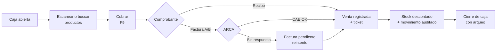

<div align="center">


# MacKiosco

### Sistema de Punto de Venta, Stock y Caja para Kioscos y Pequeños Comercios

[](https://nodejs.org)
[](https://expressjs.com)
[](https://react.dev)
[](https://vitejs.dev)
[](https://www.mysql.com)
[](https://www.arca.gob.ar)
[]()

</div>

---

## 📋 Descripción del proyecto

**MacKiosco** es un sistema web para administrar un kiosco de punta a punta: **punto de venta rápido, control de stock, caja con arqueo, compras a proveedores, clientes, reportes y usuarios con permisos**, con facturación electrónica integrada con **ARCA**.

Nace como la evolución de un sistema de escritorio para kioscos: conserva sus módulos (Facturar, Ventas, Artículos, Clientes, Proveedores, Inventario), pero con una interfaz moderna, adaptable a celular y tablet, y un flujo de venta pensado para completarse **en pocos segundos**. Se distribuye a los locales con un **instalador para Windows** que incluye todo lo necesario y un **sistema de licencias** por equipo.

## 🎯 El problema que resuelve

En un kiosco, la venta tiene que ser inmediata. Sin embargo, muchos comercios trabajan con software lento o desactualizado, o directamente con planillas. Eso trae ventas sin stock real, diferencias de caja que nadie puede explicar, precios que no se actualizan y ninguna información confiable sobre qué se vende, cuándo y con qué margen.

MacKiosco resuelve las dos cosas a la vez: el **cajero** vende con lector de código de barras y atajos de teclado, y el **dueño** tiene trazabilidad completa de cada movimiento de stock y de caja, con reportes listos para tomar decisiones.

## ✨ Características principales

### 🛒 Punto de venta
- Búsqueda por nombre o código, **compatible con lector de código de barras** (escanear + Enter agrega el producto).
- Filtro por categoría, carrito con cantidades, descuento porcentual y cliente opcional.
- Cobro con cualquier método de pago, **cálculo de vuelto** y **pago combinado** (dos métodos).
- Ticket imprimible y atajos de teclado: **F2** buscar · **F9** cobrar · **Enter** confirmar · **Esc** volver.
- No permite vender sin stock, sin caja abierta, con cantidades inválidas ni con productos inactivos. Los precios y totales **siempre se recalculan en el servidor**.

### 🧾 Recibos y facturación electrónica (ARCA)
- Al cobrar se elige el comprobante: **Recibo** (interno, no fiscal) o **Factura A/B electrónica**, validada en ARCA e impresa con **CAE y código QR**.
- **Tolerancia a fallos**: si ARCA no responde, la venta se guarda igual y la factura queda pendiente para reintentar.
- Al anular una venta facturada se emite automáticamente la **nota de crédito**.
- Sin certificado configurado, el sistema funciona solo con recibos. Guía: [docs/facturacion-arca.md](docs/facturacion-arca.md).

### 💵 Caja
- Apertura con efectivo inicial, ingresos y egresos manuales, y **cierre con arqueo**: efectivo esperado, contado y diferencia.
- Historial de cajas con el detalle por método de pago.

### 📦 Productos, inventario y compras
- Alta, edición y baja de productos con **cálculo de margen**. Un producto con ventas no se borra físicamente: se archiva para conservar el historial.
- **Inventario valorizado** (capital a costo, valor de venta, ganancia potencial), alertas de stock bajo y sin stock, y exportación a CSV.
- **Movimientos de stock auditables**: cada venta, compra, ajuste o anulación queda registrada con el stock anterior y el resultante.
- Ingreso de mercadería por proveedor, que suma stock y, opcionalmente, actualiza el costo.

### 📊 Tablero y reportes
- Ventas del día y del mes comparadas con el período anterior, ticket promedio, ganancia bruta, productos más vendidos y alertas de stock.
- Reportes por rango de fechas **por día, hora, categoría, método de pago y usuario**, más un ranking de productos, todos exportables a CSV.

### 👥 Usuarios y configuración
- Roles **Administrador** y **Cajero**, con alta, edición, desactivación y cambio de contraseña.
- Datos del comercio para el ticket y métodos de pago configurables.

### 🔐 Seguridad
- Contraseñas con **bcrypt** y sesión en **cookie httpOnly + SameSite=Strict** (no accesible desde JavaScript).
- Límite de intentos de inicio de sesión y **control de acceso por rol** en cada ruta de la API.
- **Consultas parametrizadas** en todo el backend y **validación con Zod** en el servidor, además de la del frontend.
- Los errores nunca exponen SQL ni trazas: el usuario ve mensajes claros en español.

## 🏗️ Arquitectura y stack tecnológico

El backend es una **API REST en capas** (rutas → controladores → servicios → repositorios). El mismo servidor sirve la interfaz compilada en React:

| Capa | Tecnología | Uso |
|---|---|---|
| Backend | **Node.js 20** + **Express 5** | API REST, autenticación, permisos y reglas de negocio |
| Validación | **Zod** | Esquemas de validación de todas las entradas |
| Seguridad | **JWT** · **bcrypt** · **Helmet** | Sesiones en cookie httpOnly, hash de contraseñas y cabeceras seguras |
| Base de datos | **MySQL 8** + **mysql2** | Persistencia relacional con transacciones y restricciones |
| Frontend | **React 18** + **React Router** | Interfaz SPA responsive (una pantalla por módulo) |
| Build tool | **Vite** | Compilación y recarga en caliente |
| Facturación | **ARCA** (WSAA / WSFE vía SOAP) | Autorización de comprobantes electrónicos con CAE |
| Distribución | **Inno Setup** + Node.js y MySQL embebidos | Instalador para Windows con inicio automático |
| Control de versiones | **Git** + **GitHub** | Versionado del código y de las migraciones de base |

### Decisiones de diseño destacadas

- **Todo el SQL vive en la capa de repositorios**, y las reglas de negocio en los servicios: los controladores solo reciben y responden.
- **Stock y movimientos en la misma transacción**: `productos.stock` y `movimientos_stock` nunca difieren.
- **La base protege sus propias reglas**: impide el stock negativo, dos cajas abiertas a la vez y los códigos de producto repetidos.
- **Precio y costo históricos** en cada renglón de venta, para que los reportes de ganancia no cambien cuando se actualizan los precios.
- **Migraciones versionadas** (`npm run db:migrar`): un local ya instalado se actualiza sin perder datos.
- **Licencias firmadas criptográficamente**: la clave privada nunca sale de la PC del fabricante y el instalador solo lleva la clave pública.

## 📁 Estructura del proyecto

```
MacKiosco/
├── package.json            # Atajos: instalar, db:setup, start, dev, instalador
├── iniciar.bat             # Inicio con doble clic (Windows)
├── backend/
│   ├── .env.example        # Plantilla de configuración (sin contraseñas)
│   ├── database/           # Scripts SQL: base, esquema, datos iniciales y migraciones
│   ├── scripts/            # Instalación, migraciones e historial de demostración
│   └── src/
│       ├── config/         # Variables de entorno y conexión a MySQL
│       ├── routes/         # Rutas de la API y permisos por rol
│       ├── middlewares/    # Autenticación, licencia, validación y errores
│       ├── validators/     # Esquemas Zod
│       ├── controllers/    # Reciben el pedido y devuelven la respuesta
│       ├── services/       # Reglas de negocio (ventas, stock, caja, ARCA…)
│       ├── repositories/   # Acceso a datos: todo el SQL está acá
│       └── utils/          # Dinero, fechas, paginación y errores
├── frontend/src/
│   ├── api/                # Cliente HTTP
│   ├── context/            # Sesión del usuario y avisos
│   ├── components/         # Layout, modales, tablas, gráficos, ticket
│   └── pages/              # Vender, Caja, Productos, Inventario, Reportes…
├── instalador/             # Script de Inno Setup y empaquetado
├── herramientas/           # Generador de licencias
└── docs/                   # Guías de instalación en locales y de facturación ARCA
```

### Modelo de datos (resumen)

`usuarios` · `categorias` · `proveedores` · `productos` · `clientes` · `metodos_pago` · `cajas` · `caja_movimientos` · `ventas` · `venta_detalles` · `venta_pagos` · `compras` · `compra_detalles` · `movimientos_stock` · `configuracion`

## 🚀 Instalación y puesta en marcha

> **¿Querés instalarlo en un local?** No hace falta seguir estos pasos: usá el instalador para Windows (ver [Instalación en locales](#-instalación-en-locales)). Esta sección es para desarrollo o para probar el sistema.

### Requisitos previos
- **Node.js 20** o superior (versión LTS)
- **MySQL 8.0** o superior (MySQL Installer, XAMPP o Laragon)
- Opcional: **DBeaver** o **MySQL Workbench** para ver la base

### Pasos

```bash
# 1. Clonar el repositorio
git clone https://github.com/Scomes02/MacKiosco.git
cd MacKiosco

# 2. Instalar dependencias y compilar la interfaz
npm run instalar
```

Copiá `backend/.env.example` como `backend/.env` y completá los datos de tu MySQL:

```ini
NODE_ENV=development
PORT=3001

DB_HOST=localhost
DB_PORT=3306
DB_USER=root
DB_PASSWORD=tu_contraseña_de_mysql
DB_NAME=kiosco_db

JWT_SECRET=un_texto_largo_y_aleatorio_de_al_menos_32_caracteres
SESSION_HOURS=12
```

> Para generar un `JWT_SECRET` seguro: `node -e "console.log(require('crypto').randomBytes(48).toString('hex'))"`

```bash
# 3. Crear la base, las tablas y los datos de demostración
npm run db:setup

# 4. Iniciar el sistema
npm start
```

La aplicación queda disponible en **`http://localhost:3001`**. El mismo servidor entrega la API y la interfaz. En Windows también se puede hacer **doble clic en `iniciar.bat`**.

Desde otra PC, tablet o celular de la misma red: `http://IP-DE-LA-PC:3001`.

### Datos de demostración

`db:setup` carga **174 productos reales de kiosco**, 15 categorías, proveedores, clientes y métodos de pago, más un **historial de 45 días con unas 1.900 ventas**. El historial se genera con las mismas reglas del sistema, así que el tablero y los reportes tienen datos coherentes desde el primer momento.

| Comando | Qué hace |
|---|---|
| `npm run db:setup` | Crea todo solo si la base está vacía. |
| `npm run db:reset` | **Borra todo** y vuelve a cargar los datos de demostración. |
| `npm run db:reset:vacio --prefix backend` | **Borra todo** y deja solo el catálogo, para empezar a usarlo de verdad. |
| `npm run db:migrar` | Actualiza una base existente a la última versión **sin borrar datos**. |

<details>
<summary>Alternativa manual (DBeaver / MySQL Workbench)</summary>

Ejecutá los scripts de `backend/database/` en este orden:

1. `00_crear_base.sql`: crea la base `kiosco_db`.
2. `01_schema.sql`: crea las tablas, claves, índices y restricciones.
3. `02_seed.sql`: inserta usuarios, categorías, proveedores, clientes, métodos de pago y productos.
4. Los archivos de `migraciones/` en orden, y después `npm run db:migrar` para registrar lo aplicado.

El historial de ventas de demostración solo se genera con `npm run db:setup` / `db:reset`.
</details>

### Modo desarrollo

```bash
npm run dev:api   # API en http://localhost:3001 (se reinicia al guardar)
npm run dev:web   # Interfaz en http://localhost:5173 (reenvía /api al backend)
```

Después de cambiar el frontend, `npm run build` actualiza la versión que sirve `npm start`.

## 🔑 Roles y credenciales de prueba

Solo para la **instalación de desarrollo con datos de demostración**:

| Usuario | Contraseña | Rol |
|---|---|---|
| `admin` | `admin123` | Administrador (acceso total) |
| `cajero` | `cajero123` | Cajero (vende, maneja la caja y los clientes) |
| `lucas` | `cajero123` | Cajero |

> ⚠️ **Cambiá estas contraseñas antes de usar datos reales.** El instalador para locales no trae claves por defecto: pide la del administrador durante la instalación.

## 🏪 Instalación en locales

Al local se lleva **un solo archivo**, `Instalar-MacKiosco.exe`, que incluye la aplicación, Node.js y MySQL. La PC no necesita tener nada instalado ni conexión a internet.

- **Requisitos:** Windows 10/11 de 64 bits, 4 GB de RAM y unos 600 MB libres.
- **Asistente de instalación (unos 2 minutos):** pide el nombre del kiosco, la clave del administrador, si se quiere el catálogo de ejemplo y si se va a usar en red.
- **Qué deja configurado:** una base de datos propia (no toca otros MySQL), claves únicas por PC, inicio automático con Windows y los datos guardados en `C:\ProgramData\MacKiosco`, que **nunca se borran al actualizar ni al desinstalar**.
- **Licencias:** 15 días de prueba. Después, una clave de licencia firmada que vale solo para ese equipo y tiene fecha de vencimiento.

```bash
npm run instalador   # Genera instalador/salida/Instalar-MacKiosco.exe
npm run licencia     # Emite una clave a partir del código de equipo del cliente
```

📘 **Guía completa:** [docs/instalacion-en-locales.md](docs/instalacion-en-locales.md)

## 🧩 Flujo de una venta



## 🛠️ Problemas frecuentes

| Mensaje | Solución |
|---|---|
| `Usuario o contraseña de MySQL incorrectos` | Revisá `DB_USER` y `DB_PASSWORD` en `backend/.env`. |
| `No hay ningún MySQL escuchando en localhost:3306` | Iniciá el servicio de MySQL (Servicios de Windows → MySQL80) o revisá `DB_PORT`. |
| `Falta configurar JWT_SECRET` | Completá `JWT_SECRET` en `backend/.env` (mínimo 32 caracteres). |
| `El puerto 3001 ya está en uso` | Cambiá `PORT` en `backend/.env` o cerrá el otro programa. |
| Se ve la API pero no la pantalla | Falta compilar la interfaz: `npm run build`. |

## 👨‍💻 Autor

**Santiago Comes**: diseño, desarrollo y distribución.

[](https://www.linkedin.com/in/santiago-comes)
[](https://github.com/Scomes02)
[](mailto:comessantiago@gmail.com)

## 📄 Licencia

El código se publica como portfolio. **La instalación y el uso comercial en locales requieren una licencia otorgada por el autor.** Para consultas sobre implementaciones, escribí a comessantiago@gmail.com.
